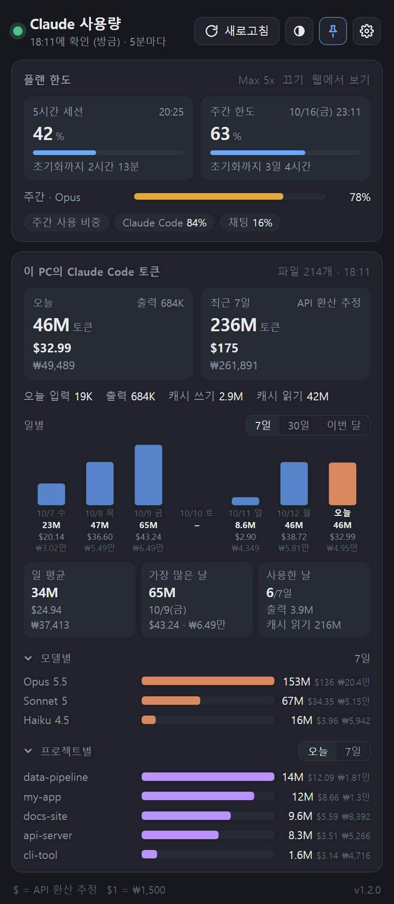
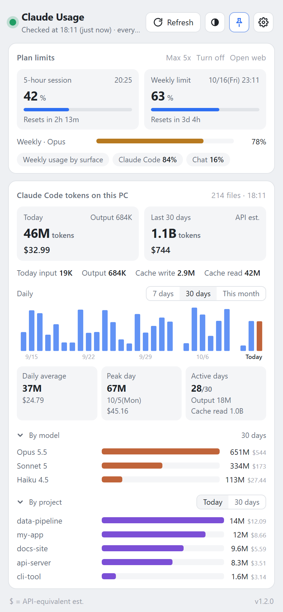

# Claude 사용량 위젯

[](https://github.com/weniv/claude-usage-widget/actions/workflows/ci.yml)
[](LICENSE)

Windows·macOS 바탕화면에 띄워 두는 작은 창(420px)입니다. **이 컴퓨터에서 Claude Code가 쓴 토큰**을 한눈에 보여주고, 원하면 **Claude 플랜 한도가 얼마나 찼는지**도 함께 보여줍니다.

> **비공식 프로젝트입니다.** Anthropic이 만들거나 보증·후원하는 프로그램이 아니며 Anthropic과 관계가 없습니다. "Claude", "Claude Code"는 Anthropic의 상표입니다.

[English summary](#english)

<p>
  
  &nbsp;
  
</p>

<sub>화면의 숫자와 프로젝트 이름은 예시 데이터입니다. 아래는 기간(7일 → 30일 → 이번 달)을 바꾸는 모습입니다.</sub>


## 보여주는 것

**이 PC의 Claude Code 토큰** (기본으로 켜져 있음, 네트워크를 쓰지 않음)

- 오늘 쓴 토큰(입력·출력·캐시 쓰기·캐시 읽기)
- 기간 통계: **최근 7일 / 최근 30일 / 이번 달**을 골라 합계, 일 평균, 가장 많이 쓴 날, 사용한 날 수를 봅니다
- 날짜별 막대그래프. 7일 보기에서는 막대마다 토큰 → 달러 → 원화를 차례로 적고, 30일·이번 달은 막대에 마우스를 올리면 값이 보입니다
- 모델별 사용량(고른 기간)
- 프로젝트별 상위 5개(오늘 / 고른 기간 전환). 프로젝트 이름은 작업 폴더 이름입니다.
- **API 환산 추정($)**: 같은 토큰을 Claude API 공개 단가로 썼다면 얼마인지 계산한 **추정치**입니다. 구독 요금과는 관계없습니다. 캐시 쓰기는 5분 TTL에 1.25배, 1시간 TTL에 2배, 빠른 모드는 2배로 계산합니다. 단가표는 `claude_usage_widget.pyw`의 `PRICES`에 있으며, 단가를 모르는 모델은 환산에서 빼고 화면에 따로 알려줍니다.
- **내 통화(₩·¥·€ …)**: 달러 환산값을 환율로 바꾼 값을 달러 아래에 함께 보여 줍니다. 통화는 Windows 지역 설정을 따르고(한국이면 원화, 기본 1,500원), [설정]에서 바꾸거나 "달러만 표시"로 끌 수 있습니다. 환율 시세는 가져오지 않으니(네트워크를 쓰지 않음) 직접 고쳐 쓰세요. 아래쪽 `$1 = ₩1,500`을 누르면 바로 환율 칸으로 갑니다.
- 기록이 하나도 없으면(Claude Code를 아직 안 썼거나 폴더가 없으면) 무엇을 하면 되는지 안내합니다.

**플랜 한도** (기본으로 꺼져 있음, [아래](#플랜-한도-켜기-선택) 참고)

| 항목 | 내용 |
|---|---|
| 5시간 세션 | 사용률(%), 초기화 시각, 초기화까지 남은 시간 |
| 주간 한도 | 전체 모델 기준 주간 사용률(%)과 초기화 시각 |
| 모델별 주간 한도 | 모델별 한도가 따로 있을 때만 표시 |
| 추가 사용량 | 추가 사용량(크레딧)이 켜져 있을 때만 사용액 / 월 한도 표시 |
| 주간 사용 비중 | Claude Code·채팅 등 어디서 썼는지 비율 |

막대 색은 서버가 알려주는 심각도(severity)를 따릅니다. 보통은 파랑, 주의는 주황, 위험은 빨강입니다.

## 요구 사항

- Windows 10/11 (Edge WebView2 런타임, 보통 이미 설치되어 있음) 또는 macOS 11 이상 (Apple 실리콘·Intel)
- Claude Code를 이 컴퓨터에서 쓰고 있을 것 (`~/.claude`, Windows는 `%USERPROFILE%\.claude`)
- 소스로 실행할 때: Python 3.11 이상

Linux는 지원하지 않습니다.

## 설치와 실행

### exe로 받기

[Releases](https://github.com/weniv/claude-usage-widget/releases)에서 `claude_usage_widget.exe`를 받아 실행합니다. 설치 과정은 없습니다.

- exe는 **WENIV Corp.** 이름으로 코드 서명되어 있습니다(Azure Artifact Signing). 파일 [속성] → [디지털 서명]에서 확인할 수 있고, 같이 올린 `.sha256`으로 해시도 확인할 수 있습니다.
- exe는 태그를 달 때 GitHub Actions(`.github/workflows/release.yml`)가 이 저장소 소스로 빌드하고 서명합니다.

### macOS 앱 받기

[Releases](https://github.com/weniv/claude-usage-widget/releases)에서 Mac 칩에 맞는 zip을 받습니다. 어떤 칩인지는 Apple 메뉴 → [이 Mac에 관하여]의 "칩"(Apple M…이면 Apple 실리콘) 또는 "프로세서"(Intel)에서 확인합니다.

- `claude_usage_widget-macos-apple-silicon.zip` — M1~M4 등 Apple 실리콘
- `claude_usage_widget-macos-intel.zip` — Intel Mac

zip을 풀어 나온 `Claude Usage Widget.app`을 **[응용 프로그램] 폴더로 옮긴 뒤** 엽니다. (옮기지 않고 열면 macOS가 임시 경로에서 실행해 [로그인 시 실행]을 등록할 수 없습니다.)

- 앱은 Apple Developer ID로 서명하고 Apple 공증을 받았습니다(1.3.1부터). 처음 열 때 "인터넷에서 다운로드한 앱입니다" 확인만 뜨고, [열기]를 누르면 바로 실행됩니다.
- 플랜 한도를 켜면 macOS가 키체인의 "Claude Code-credentials"에 접근해도 되는지 묻습니다. macOS의 Claude Code는 로그인 토큰을 파일이 아니라 키체인에 저장하기 때문입니다. 로그인 암호를 넣고 [항상 허용]을 누르면 다음부터 묻지 않습니다. 플랜 한도를 켜지 않으면 키체인을 읽지 않습니다.
- 창을 닫거나 ⌘Q로 끝냅니다. Dock 아이콘을 다시 누르면 떠 있는 창이 앞으로 옵니다.

### 소스로 실행

macOS: `pip3 install -r requirements.txt` 후 `python3 claude_usage_widget.pyw`

```powershell
pip install -r requirements.txt
pythonw claude_usage_widget.pyw     # 콘솔 창 없이 실행
python  claude_usage_widget.pyw     # 오류를 콘솔에서 보고 싶을 때
```

- 이미 켜져 있으면 새로 띄우지 않고, 켜져 있던 창을 앞으로 가져옵니다.
- 머리의 버튼은 [새로고침], 테마(자동 → 라이트 → 다크), 핀(항상 위), 설정(톱니바퀴)입니다.
- **설정**: 언어(자동 / 한국어 / English), 통화와 환율, 자동 새로고침 간격, **Windows 시작 시 실행**(macOS는 **로그인 시 실행**), 플랜 한도 카드 표시.
  - 화면 언어는 Windows 언어를 따릅니다. 표시 언어나 지역 중 하나가 한국어면 한국어, 아니면 영어입니다.
  - Windows 시작 시 실행은 `HKCU\Software\Microsoft\Windows\CurrentVersion\Run`에 `ClaudeUsageWidget` 값 하나를 넣고 뺍니다. 켜 둔 채 위젯 폴더나 exe를 옮기면 다음에 실행할 때 새 위치로 고쳐 둡니다.
  - macOS 로그인 시 실행은 `~/Library/LaunchAgents/kr.co.weniv.claude-usage-widget.plist` 파일 하나를 만들고 지웁니다. 처음 켜면 macOS가 "백그라운드 항목이 추가됨" 알림을 보여 줄 수 있습니다.
  - 플랜 한도를 쓰지 않으면 카드가 한 줄로 줄어들고, [플랜 한도 카드 표시]를 끄면 아예 숨깁니다.
- [모델별]·[프로젝트별] 제목을 누르면 목록을 접고 펼 수 있습니다. 접으면 제목 옆에 가장 많이 쓴 항목과 합계만 보이고, 접은 상태는 다음에 켤 때도 이어집니다.
- 모니터를 떼어 내서 저장된 창 위치가 화면 밖이면 기본 위치(주 모니터 오른쪽 위)로 다시 띄웁니다.

### 바탕화면 바로가기

```powershell
powershell -ExecutionPolicy Bypass -File .\make_shortcut.ps1
```

바탕화면에 `Claude 사용량 위젯.lnk`가 생깁니다. 대상은 `pythonw.exe "…\claude_usage_widget.pyw"`이라서 콘솔 창이 뜨지 않습니다.

### exe 직접 빌드

```powershell
pip install -r requirements.txt pyinstaller
powershell -ExecutionPolicy Bypass -File .\build_exe.ps1
```

결과는 `dist\claude_usage_widget.exe`입니다.

macOS에서는 `pip3 install -r requirements.txt pyinstaller` 후 `./build_app.sh`를 실행하면 `dist/Claude Usage Widget.app`과 zip이 생깁니다(ad-hoc 서명). Apple Developer ID로 서명·공증하려면 `sign_app.sh` 머리에 적힌 환경변수를 넣고 이어서 실행합니다. CI에서는 같은 이름의 GitHub Secrets가 있을 때만 서명·공증하고, 없으면 ad-hoc 서명본을 올립니다.

서명까지 하려면 `AZURE_TENANT_ID`·`AZURE_CLIENT_ID`·`AZURE_CLIENT_SECRET` 환경변수를 넣고 `sign_exe.ps1`을 실행합니다(Windows SDK의 `signtool.exe` 필요). CI에서는 같은 이름의 GitHub Secrets를 씁니다.

## 플랜 한도 켜기 (선택)

플랜 한도는 Claude Code가 이 PC에 저장해 둔 로그인 토큰으로 `GET https://api.anthropic.com/api/oauth/usage`를 불러 가져옵니다. 이 엔드포인트는 **공개 문서에 없고**, Anthropic은 [OAuth 인증을 Claude Code와 Anthropic 자체 앱의 일반적인 사용을 위한 것](https://code.claude.com/docs/en/legal-and-compliance#authentication-and-credential-use)이라고 안내합니다. 그래서 이 기능은 **기본으로 꺼져 있고**, 위젯의 플랜 한도 카드에서 [켜는 방법]을 눌러 안내를 읽고 [이해했고, 플랜 한도 켜기]를 눌러야 동작합니다. 카드 제목 줄의 [끄기]로 언제든 다시 끌 수 있습니다.

- 켜지 않아도 [웹에서 보기]로 claude.ai 사용량 페이지를 열어 같은 숫자를 볼 수 있습니다.
- 꺼져 있으면 자격 증명 파일(`.credentials.json`)을 **열지도 않습니다**.
- 엔드포인트는 예고 없이 바뀌거나 막힐 수 있습니다. 위젯은 아는 값만 꺼내고 모르는 값은 무시합니다. 형식이 크게 바뀌면 "응답 형식이 바뀐 것 같습니다"라고 표시되니, 그때는 `parse_usage()`를 고쳐 주세요.
- 켜고 끄는 것은 사용자 본인의 판단입니다. 이 프로젝트는 그 사용에 대해 어떤 보증도 하지 않습니다(LICENSE 참고).

## 데이터는 어디서 오나

| 구분 | 출처 | 언제 |
|---|---|---|
| Claude Code 토큰 | `~/.claude/projects/**/*.jsonl`(Claude Code 대화 기록) | 켤 때, [새로고침], 30초마다 |
| 플랜 한도(켰을 때만) | `api/oauth/usage`에 Claude Code 로그인 토큰을 붙여 요청 | 켤 때, [새로고침], 자동 새로고침 간격마다(기본 5분, 최소 1분). 초기화 시각이 지나면 곧바로, 토큰이 갱신되면(로그인 파일이 바뀌면) 30초 안에 |
| 플랜 이름(켰을 때만) | `api/oauth/profile`(같은 토큰). 실패하면 로그인 파일에 적힌 플랜 | 1시간에 한 번 |

- 로그인 토큰은 Windows에서는 `~/.claude/.credentials.json`, macOS에서는 키체인의 `Claude Code-credentials` 항목에서 읽습니다(키체인에 없으면 같은 파일을 봅니다).
- 플랜 이름을 로그인 파일(`.credentials.json`)이 아니라 서버 프로필에서 가져오는 이유: 로그인 파일의 플랜은 로그인할 때 값이라, 그 뒤에 플랜을 바꾸면(예: Max 5x → 20x) 예전 이름이 남습니다.
- Claude Code 설정 폴더를 옮겨 쓰고 있다면(환경 변수 `CLAUDE_CONFIG_DIR`) 그 폴더를 읽습니다.
- jsonl 기록에서 같은 응답이 스트리밍 중에 여러 줄로 남기 때문에 `message.id` + `requestId`로 중복을 걸러 냅니다. 같은 응답의 줄 중에서는 항목별로 가장 큰 값(최종값)을 씁니다.
- 기록 파일은 모두 합치면 수 GB가 될 수 있습니다. 파일마다 어디까지 읽었는지 기억해 두고 **새로 붙은 부분만** 읽습니다. 처음 한 번은 몇 초 걸리고(약 1.8GB 기준 3~4초), 그 뒤로는 0.2초 안팎입니다.

## 저장하는 파일

Windows는 `%LOCALAPPDATA%\claude-usage-widget\`, macOS는 `~/Library/Application Support/claude-usage-widget/` 아래에 있고, 이 컴퓨터 밖으로 나가지 않습니다.

| 파일 | 내용 |
|---|---|
| `widget.json` | 창 위치·크기, 항상 위, 새로고침 간격, 테마, 언어, 통계 기간, 프로젝트 기간, 통화·환율, 접은 목록, 플랜 한도 켜기·카드 표시 |
| `usage_cache.json` | 응답별 토큰 수·모델·작업 폴더 이름·시각(최근 35일), 파일별 읽은 위치. 대화 내용은 저장하지 않음 |
| `webview\` | WebView2 브라우저 데이터 (Windows) |
| `widget.lock` | 두 번 켜지지 않게 잡는 잠금 파일 (macOS) |

예전 버전처럼 스크립트(exe) 옆에 `widget.json`이 있으면 처음 한 번 그 설정을 이어받습니다. 위젯을 지우려면 [설정]에서 시작 시 실행(로그인 시 실행)을 끈 뒤 이 폴더를 지우면 됩니다. macOS는 앱도 휴지통으로 옮깁니다.

## 보안·개인정보

- **토큰은 이 PC 안에서만 씁니다.** 플랜 한도를 켰을 때 요청할 때마다 파일에서 새로 읽어 `api.anthropic.com`으로 보내는 요청 헤더에만 넣고, 화면(JS)·로그·설정·캐시 어디에도 남기지 않습니다.
- 자격 증명 파일·키체인은 **읽기만** 합니다. 토큰을 갱신하거나 파일을 고치지 않습니다. 토큰이 만료되었거나 서버가 401을 돌려주면 "Claude Code를 한 번 실행하면 토큰이 갱신됩니다"라고 안내합니다. 그동안 남아 있는 예전 값은 가져온 시각과 함께 보여 주고, 초기화 시각이 지난 한도는 예전 퍼센트 대신 "초기화됨"으로 표시합니다.
- `api.anthropic.com`(플랜 한도를 켰을 때만) 말고는 어떤 서버에도 접속하지 않습니다. 사용 통계·원격 측정이 없습니다.
- 화면에서 부를 수 있는 기능은 정리된 숫자를 돌려주는 것뿐입니다(`plan`, `local`, `get_conf`, `set_conf`, `open_usage_page`). 파일 내용이나 임의 경로를 돌려주는 기능은 없고, `set_conf`는 정해진 설정 키와 값만 받습니다.
- 화면은 로컬 HTTP 서버 없이 HTML 문자열로 띄웁니다. 그래서 같은 pywebview 방식의 다른 앱과 함께 켜도 포트(42001)가 겹치지 않습니다.
- 보안 문제를 발견하면 공개 이슈 대신 GitHub의 [Security → Report a vulnerability](https://github.com/weniv/claude-usage-widget/security/advisories/new)로 알려 주세요.

## 개발

```powershell
python -m unittest discover -s tests -v
```

테스트는 창·네트워크 없이 응답 파싱, 단가 계산, jsonl 증분 읽기·중복 제거, 설정 검증, macOS 분기(키체인·LaunchAgent·언어)를 확인합니다. `main`에 push하거나 PR을 열면 GitHub Actions가 Windows·macOS × Python 3.11·3.13에서 돌리고, Mac .app을 빌드해 Actions 결과물로 올립니다.

릴리스: `claude_usage_widget.pyw`의 `VERSION`을 올리고 같은 이름의 태그(`v1.2.3`)를 push하면 exe를 빌드·서명하고 Mac zip(Apple 실리콘·Intel)을 빌드해 Release에 올립니다.

| 파일 | 내용 |
|---|---|
| `claude_usage_widget.pyw` | 데이터 가져오기(플랜 한도·jsonl 집계), 창, JS API |
| `widget.html` | 화면(카드·타일·막대그래프, 다크/라이트, 한국어/영어 글자) |
| `docs/` | README 스크린샷(예시 데이터) |
| `tests/` | 단위 테스트 |
| `make_shortcut.ps1` | 바탕화면 바로가기 만들기 (Windows) |
| `build_app.sh` | PyInstaller .app 빌드 (macOS) |
| `sign_app.sh`, `entitlements.plist` | .app Developer ID 서명·공증 (macOS, 선택) |
| `build_exe.ps1` | PyInstaller exe 빌드 |
| `sign_exe.ps1` | exe 코드 서명(Azure Artifact Signing) |

## 라이선스

[MIT](LICENSE)

---

## English

**Claude Usage Widget** is a small, unofficial Windows and macOS desktop widget (Python + pywebview / Edge WebView2 or WKWebView) that shows:

- **Local Claude Code token usage** — today, last 7 days, last 30 days or this month (total, daily average, peak day), per model and per project, read incrementally from `~/.claude/projects/**/*.jsonl` (respects `CLAUDE_CONFIG_DIR`). Includes an *estimated* cost at public API prices, optionally also shown in your currency (KRW, JPY, EUR, GBP, …; picked from your Windows region) at an exchange rate you set. No network access.
- **Plan limits (opt-in, off by default)** — 5-hour session and weekly usage from the undocumented `api.anthropic.com/api/oauth/usage` endpoint, using the OAuth token Claude Code already stored locally (`~/.claude/.credentials.json`, or the macOS Keychain item `Claude Code-credentials` — macOS asks once for Keychain access). Because the endpoint is undocumented and Anthropic states that OAuth authentication is intended for Claude Code and Anthropic's own apps, you must explicitly enable it in the widget. When disabled, the credentials file is never opened. The token is never stored, logged, or passed to the UI.

This project is not affiliated with, endorsed, or sponsored by Anthropic. "Claude" and "Claude Code" are trademarks of Anthropic.

The UI is in **English or Korean**, following your Windows language (changeable in Settings). Settings (gear icon) also cover currency and exchange rate, refresh interval, **Start with Windows** (a single `HKCU\...\Run` value, repaired automatically if you move the exe), and hiding the plan limits card.

Download the exe (Windows) or the macOS zip for your chip (`apple-silicon` or `intel`) from [Releases](https://github.com/weniv/claude-usage-widget/releases). On macOS, move the app to Applications; it is signed with an Apple Developer ID and notarized (since 1.3.1), so it opens normally. Or run from source: `pip install -r requirements.txt` then `pythonw claude_usage_widget.pyw` (macOS: `python3 claude_usage_widget.pyw`). Settings and cache live in `%LOCALAPPDATA%\claude-usage-widget\` (Windows) or `~/Library/Application Support/claude-usage-widget/` (macOS); "Start with Windows" becomes "Open at login" (a LaunchAgent plist) on macOS. Licensed under MIT.
